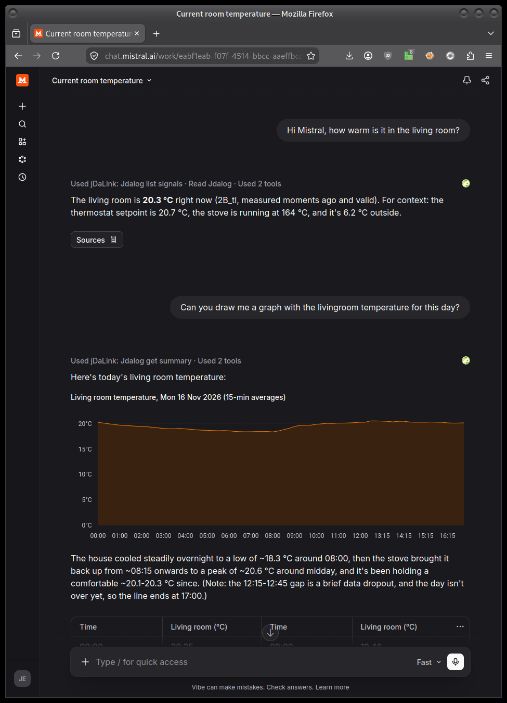

# jDaLink — jDaLog MCP Gateway

**jDaLink** is an MCP gateway (Python, FastMCP) that exposes the measurement data of **jDaLog** — a custom C++ datalogger for Siemens S7 and Modbus, running on a linux host — to language models such as Mistral. jDaLog gained JSON output specifically for this pipeline; the shim translates it into self-describing tool responses that an LLM can read without any context.

**Goal:** expose the data living in the datalogger for LLM processing — read, interpret, and report on the house's measurements, without touching the logger's core.

The full chain:

```
S7/Modbus sensors → jDaLog (C++, binary store) → /in.json (HTTP)
→ jDaLink MCP shim (Python/FastMCP) → Nginx + certbot (TLS tunnel)
→ Mistral connectors → chat
```

A single measurement travels from the real world to the conversation in a few seconds.



## Scope: read-only, by design

jDaLink is the **human-machine interface layer**: asking, explaining, investigating, and printing. The home automation itself is already automated, predictably and with low cognitive load — an external writer could add no value, only risk. Write/control tools are therefore **not on the roadmap**; read is the full scope. The one physical output channel is the printer: a deliberate MMI fun tool, not a controller.

## The tools

| Tool | Function |
|---|---|
| `jdalog_list_signals` | Full inventory: all signals with name, value, unit, age, validity, and timestamp |
| `jdalog_get_latest` | Query a single signal, same honest schema |
| `jdalog_get_summary` | Time-aggregated statistics for multiple signals: time-weighted min/avg/max per bin, coverage (`pvalid`), sample counts, optional edge counters (`include_edges`) |
| `jdalog_get_lastchange` | Last value *change* of a signal (ISO timestamp + seconds since + value before), for counters and discretes |
| `jdalog_print` | Print text on the Epson FX-800 dot-matrix printer: ASCII-transliterated, 80 columns, fire-and-forget queue |

Every response is **self-describing** — readable by an LLM (or human) without any context:

```json
{
  "signal": "2B_tl",
  "name": "2B living room temperature",
  "value": 19.55,
  "unit": "degC",
  "decimals": 2,
  "age": 1.34,
  "valid": true,
  "time": "2026-10-31T16:41:04.817+01:00"
}
```

Aggregates follow the same discipline: the LLM gets answers, not raw sample lists — `duration_above`, `integral` and friends are planned as the next family, implemented on jDaLog's binary store where the data lives.

## Installation & usage

```bash
uv sync            # restore the environment from pyproject.toml + uv.lock
uv run server.py   # starts the shim (port per conf.json)
```

Requirements elsewhere:

- **jDaLog** serves `/in.json` (per signal: epoch time, unit, `age`, `valid`) — a JSON output added to the logger specifically for this pipeline;
- **Nginx + certbot** provide the TLS tunnel to the outside world;
- **Mistral** has the connector (`jdalink`) enabled on the account that should read along.

Copy `conf.json.example` to `conf.json` and fill in the jDaLog address and tokens. (`conf.json` is in `.gitignore` — the repo documents the shape, not your house.)

## Design principles

1. **The source is authoritative, not the receiver.** Timestamps originate as epochs from jDaLog itself; the shim only translates them to ISO 8601 with milliseconds and `Europe/Amsterdam`. DST holds down to the historical layer: a dead sensor from 12 October still carries its correct `+02:00`.
2. **Explicit over compact.** Units are *always* present (`""` where no unit applies — omitted is ambiguous, `""` is a deliberate null). Times are *always* ISO. One stable schema for all signals.
3. **Discipline belongs in the code, not in hope.** Wherever an LLM might forget something (consulting the overview, using units, embedding data in text), the guarantee belongs in the tool — not in the prompt.
4. **Correct, then simple, then fast.** `get_latest` fetches the entire `/in.json` and passes one signal through — inefficient on paper, negligible on localhost. Optimize only when there is a measurable problem.
5. **TLS is not an afterthought but the wall.** Nginx with certbot is what lets an AI assistant talk to the home's data safely — and only there.
6. **The LLM reads; the PLC rules.** No language model ever sits in a control loop. Regulation is deterministic, on the S7, with priority and veto rights staying local — forever.

## Colophon

Built by jce, with Mistral as pair programmer. All hands: S7, jDaLog, jDaLink, Nginx, certbot, Mistral — and a meter closet that can finally be read.
